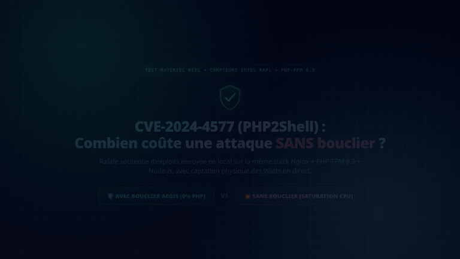

# 🛡️ Aegis par AIVO — Suite Souveraine Zero-Trust & Cockpit ESG (AGPLv3)

<p align="center">
  <a href="README.md">English</a> | <strong>Français</strong> •
  <a href="VISION.fr.md">Vision & Principes</a> •
  <a href="ROADMAP.fr.md">Roadmap</a> •
  <a href="CHANGELOG.fr.md">Changelog</a> •
  <a href="CONTRIBUTING.fr.md">Contribuer (Gitflow)</a> •
  <a href="SECURITY.md">Sécurité</a> •
  <a href="LICENSE">Licence (AGPLv3)</a>
</p>

<p align="center">
  
  
  
  
  
  
  
</p>

<p align="center">
  <a href="https://demo.aegis.aivo.fr/fr/demo" target="_blank">
    
  </a>
  <a href="https://github.com/aivo-labs/aegis/releases/tag/v1.3.0-beta">
    
  </a>
  <a href="https://aegis.aivo.fr/fr/" target="_blank">
    
  </a>
</p>

> [!TIP]
> **Testez Aegis en 1 clic (Sans aucune installation)** : Vous pouvez expérimenter le Fuzzer d'entropie de Shannon en direct, le replayer d'impact matériel PHP2Shell et le Kanban SOC directement sur notre démonstrateur en ligne : **[demo.aegis.aivo.fr/fr/demo](https://demo.aegis.aivo.fr/fr/demo)**.

**Centre de Contrôle Opérationnel (SOC), Protection In-Line (Ingress/Egress) & Pilotage Énergétique Conforme RGESN / ANSSI / EFRAG**

Aegis est une suite logicielle unifiée conçue pour sécuriser le système d'information des PME/ETI et piloter sa sobriété numérique selon le modèle **Open-Core Éthique (AGPLv3)**. Développé en **Go et Rust**, Aegis fonctionne comme une surcouche transparente ultra-frugale (< 200 Mo RAM hors modèle LLM local) sans aucune taxe SaaS par siège.

---

## ⚡ Preuve Matérielle en Direct : Attaque CVE-2024-4577 (PHP2Shell) — Avec vs Sans Bouclier

<p align="center">
  
</p>

> *Mesuré en local sur `Intel(R) Core(TM) i5-8350U CPU @ 1.70GHz (8 vCPUs)` par lecture matérielle directe (`/sys/class/powercap/intel-rapl:0` + `/proc/stat`) face à une rafale soutenue `CVE-2024-4577` ciblant une stack Nginx + PHP-FPM 8.3 + Node.js (`602` requêtes bloquées vs `126` compromissions sans bouclier).*

| Indicateur Mesuré | 🛡️ Avec Bouclier Aegis (Edge PEP) | 💥 Sans Bouclier (PHP-FPM 8.3 exposé) | Gain Aegis |
| :--- | :---: | :---: | :---: |
| **Interception PHP2Shell** | **100 %** (`602 / 602` HTTP `403`) | **0 %** (`126 / 126` HTTP `200` exploitées) | Blocage périmétrique total |
| **Charge CPU PHP-FPM Cible** | **0 %** moy. / **0 %** pic | **537,98 %** moy. / **743,4 %** pic | Zéro saturation applicative |
| **Puissance Intel RAPL (Moy / Pic)** | **5,81 W** / **16,01 W** | **24,14 W** / **37,58 W** | **+315,5 %** Watts moy. sans bouclier |
| **Énergie Cumulée Mesurée** | **101,04 J** | **438,91 J** (`+337,9 J` gaspillés) | **×4,34** d'énergie consommée |
| **Latence HTTP Moyenne** | **17,33 ms** | **2619,57 ms** | Réponse **151×** plus rapide |

---

## 🏛️ Architecture & Cartographie des Services

```
                        [ TRAFIC ENTRANT (Ingress Web & API) ]
                                          │
                                          ▼
       ┌─────────────────────────────────────────────────────────────────┐
       │     Aegis Gate PEP / WAF (apps/gate-proxy : Port 8000)          │
       │     Interception in-line OWASP & Scanners (Nikto, SQLmap, RCE)  │
       └────────────────────────────────┬────────────────────────────────┘
                     ┌──────────────────┴──────────────────┐
              (Trafic Bloqué 403)                   (Trafic Légitime 200)
                     │                                     │
                     ▼                                     ▼
       ┌───────────────────────────┐         ┌───────────────────────────┐
       │   Aegis Backend (Go)      │         │    Aegis Web Cockpit      │
       │   (apps/backend : 8080)   │ ◀────── │    (apps/web : 4321)      │
       │   • Triage Feed / API     │         │    • Astro 5 + Vue 3      │
       │   • Scanner Passif Réel   │         │    • Reverse-proxy /docs  │
       └─────────────┬─────────────┘         └─────────────┬─────────────┘
                     │                                     │
                     ▼                                     ▼
       ┌───────────────────────────┐         ┌───────────────────────────┐
       │  TimescaleDB (Port 5432)  │ ◀────── │  Aegis Docs (Starlight)   │
       │  (Hypertables Télémétrie) │         │  (apps/docs : profile)    │
       └───────────────────────────┘         └───────────────────────────┘
                     ▲                                     ▲
                     │ (Télémétrie Énergétique)            │ (Sinkhole DNS & IA)
       ┌───────────────────────────┐         ┌───────────────────────────┐
       │ Aegis Telemetry Agent     │         │ Aegis Egress (Port 5053)  │
       │ (apps/telemetry-agent)    │         │ CoreDNS durci + SLM Local │
       │ Sonde Rust RAPL (/sys)    │         │ Nimble 9B (Ollama :11434) │
       └───────────────────────────┘         └───────────────────────────┘
```

### Cartographie des Ports

| Service | Port Public | Technologie | Rôle Opérationnel |
| :--- | :--- | :--- | :--- |
| **`web`** | **`4321`** (-> 80) | Astro 5, Vue 3, Nginx | **Cockpit SOC & ESG Unifié**, Triage Kanban, Documentation `/docs/`. |
| **`gate-proxy`** | **`8000`** | Go / Node.js Reverse-Proxy | **Passerelle Ingress PEP / WAF** (latence < 1.5 ms, RAM < 25 Mo). |
| **`backend`** | **`8080`** | Go natif (Zero-Mock) | **API Control Plane Go** (Triage feed, scanner passif, métriques). |
| **`egress-gateway`** | **`5053` (UDP/TCP)** | CoreDNS & SLM Inférence | **Passerelle Egress DNS** (Cache CTI + IA locale Nimble 9B). |
| **`telemetry-agent`**| *Host network* | Rust compilé natif | **Sonde Matérielle** (Watts réels Linux RAPL `/sys/class/powercap`). |
| **`timescaledb`** | **`5432`** | PostgreSQL 16 + TimescaleDB | **Stockage Sécurisé Souverain** (Logs immuables & séries temporelles). |
| **`ollama-nimble`** | **`11434`** | Ollama Air-Gapped | **IA Locale Nimble 9B** (0 jeton transmis à des tiers américains). |
| **`docs`** | *Interne* (`/docs/`) | Astro Starlight | **Documentation Officielle** (Profile Docker `--profile docs`). |

---

## 🎛️ Architecture & Services
 
Aegis est architecturé comme une suite Zero-Trust souveraine, autonome et sans aucune dépendance aux clouds des GAFAM :

### 1. Ingress PEP & Token Handler Pure BFF (`gate-proxy:8000`)
- **Latence ultra-faible (< 1,5 ms)** : WAF OWASP Top 10, Virtual Patching, calcul d'entropie de Shannon et réputation IP dynamique.
- **Pure BFF Token Handler** : Scellement de session chiffré AES-256-GCM via cookies HttpOnly (compatible Keycloak OIDC ou mode autonome souverain). Zéro fuite de jetons dans le JavaScript du navigateur.

### 2. Cockpit SOC & ESG Unifié (`web:4321`)
- Cartographie des cyberattaques en temps réel, flux SSE en direct, commandes WAF instantanées et jauges de consommation électrique matérielle.
- Accessible directement ou via le point d'entrée Ingress PEP à l'adresse `/app/`.

### 3. Portail Communautaire Souverain (`/`)
- Page d'accueil sobre et minimaliste sur `/` (EN) et `/fr/` (FR) offrant un accès en 1 clic au Cockpit SOC, à la documentation technique et au dépôt GitHub.

---

## 📋 Prérequis

* **Système d'exploitation** : Linux (Ubuntu 22.04/24.04, Debian 12, Rocky Linux 9, etc.) ou macOS.
* **Docker Engine** : version 24.0+ (`docker --version`).
* **Docker Compose** : version v2.20+ (`docker compose version`).
* **Ressources recommandées** :
  * *Standard (sans modèle IA lourd)* : 2 vCPU, 2 Go RAM, 20 Go SSD.
  * *Complet (avec inférence locale Nimble 9B)* : 4 vCPU, 8 Go RAM (ou GPU compatible).

---

## 🚀 Démarrage Rapide

### 0. Ou testez directement le démonstrateur en ligne
Sans aucune installation requise : **[demo.aegis.aivo.fr/fr/demo](https://demo.aegis.aivo.fr/fr/demo)** (Français) | **[demo.aegis.aivo.fr](https://demo.aegis.aivo.fr)** (English).

### 1. Cloner le dépôt
```bash
git clone https://github.com/aivo-labs/aegis.git
cd aegis
```

### 2. Démarrer la suite complète
```bash
# Démarre l'ensemble des conteneurs en mode souverain
docker compose up -d

# (Optionnel) Démarrer également le conteneur de documentation officielle
docker compose --profile docs up -d
```

### 3. Accéder aux interfaces
- **Point d'entrée principal Ingress PEP & WAF** : `http://localhost:8000/`
- **Cockpit SOC & ESG Unifié** : `http://localhost:8000/app/` (ou `http://localhost:4321/app/`)
- **Mire de Connexion Souveraine (Pure BFF)** : `http://localhost:8000/login/` (EN) | `http://localhost:8000/fr/login/` (FR)
- **Documentation Technique (Starlight)** : `http://localhost:8000/docs/` (ou port 4322)
- **Support Bilingue (i18n)** : Anglais par défaut à la racine, Français sous le préfixe `/fr/`, avec bascule de langue sur toutes les barres de navigation.

---

## 🌐 Déploiement VPS & PaaS (Dokploy, Coolify, Traefik)

L'architecture Nginx d'Aegis a été conçue pour une portabilité totale sur VPS sans configuration complexe :
- **Composition Dokploy dédiée** : Utilisez `docker-compose.dokploy.yml` sur Dokploy pour rattacher automatiquement `gate-proxy` et `egress-gateway` au réseau `dokploy-network`.
- **Zéro port tiers à exposer** : L'API Go (`/api/`) et la documentation (`/docs/`) sont relayées de façon transparente via le réseau bridge interne de Docker.
- **Redirections relatives préservées** : Grâce aux directives Nginx `absolute_redirect off;` et `port_in_redirect off;`, Traefik et les reverse-proxies SSL gèrent le trafic sans perte de port ou de protocole.

---

## 🧪 Validation du Banc d'Essai & Batterie de Pentest

Un script automatisé de simulation d'attaques réelles est inclus pour tester l'interception in-line et vérifier sa remontée instantanée dans le Cockpit :

```bash
./scripts/run-pentest-demo.sh
```

### Attaques simulées et bloquées :
1. **Scanners automatisés** : Détection du User-Agent `Nikto/2.1.6` (**403 Forbidden**).
2. **Injections SQL (SQLi)** : Payload `' UNION SELECT username,password FROM users--` (**403 Forbidden**).
3. **Traversée de répertoires (LFI)** : Requête vers `../../../../etc/passwd` (**403 Forbidden**).
4. **Exécution de commandes à distance (RCE)** : Payload `; cat /etc/shadow` (**403 Forbidden**).
5. **Cross-Site Scripting (XSS)** : Injection de balises `<script>` (**403 Forbidden**).
6. **Exfiltration DNS & C2** : Résolution de domaine malveillant sur le port `5053` (**Sinkhole 0.0.0.0**).
7. **Algorithme DGA** : Détection par entropie de Shannon et quarantaine via le modèle SLM **Nimble 9B**.
8. **Flux Conforme** : Requête authentifiée transmise avec latence inférieure à 1.5 ms (**200 OK**).

---

## ⎈ Déploiement Kubernetes & Helm

Aegis supporte le déploiement sur Kubernetes avec attribution énergétique granulaire par Namespace grâce à **Kepler eBPF** :

* **Installation Helm en 1 commande** :
  ```bash
  helm upgrade --install aegis ./deploy/kubernetes/helm/aegis \
    --namespace aegis-system \
    --create-namespace
  ```
* **Manifestes purs (GitOps / ArgoCD)** :
  ```bash
  kubectl apply -f deploy/kubernetes/manifests/
  ```

---

## 📁 Structure du Projet

```
aegis/
├── apps/
│   ├── backend/            # Moteur souverain en Go natif (API REST, Scanner passif, Honeypot)
│   ├── docs/               # Documentation officielle en Astro Starlight (Bilingue EN/FR)
│   ├── egress-gateway/     # Passerelle DNS sortante avec CoreDNS durci & Sinkhole C2
│   ├── gate-proxy/         # Passerelle Ingress PEP / WAF ultra-légère (< 25 Mo RAM)
│   ├── telemetry-agent/    # Sonde matérielle native en Rust (Watts réels Linux RAPL)
│   └── web/                # Interface unifiée : Cockpit SOC Vue 3, Kanban, Landing page Astro 5
├── deploy/
│   ├── docker-compose/     # Variantes Docker (bare-metal, enterprise)
│   └── kubernetes/         # Chart Helm et manifestes Kubernetes
├── docs/                   # Livres blancs, comparatifs techniques et guides d'architecture
├── scripts/                # Scripts d'installation et bancs d'essai de pentest
└── docker-compose.yml      # Composition Docker officielle
```

---

## ⚖️ Licence & Engagements

* **Licence Libre** : Distribué sous licence **AGPLv3** (*GNU Affero General Public License v3*). Code source auditable et librement modifiable.
* **Souveraineté** : Conçu en France par **AIVO Labs** — Immunisé contre le Cloud Act américain.
* **Conformité Réglementaire** : Prêt pour **NIS 2**, **DORA**, le **RGESN 2024** et la **Norme VS (EFRAG 2026)**.

---

## 🧭 Matrice des Priorités de Développement

Pour le détail des verrous techniques, de l'état réel dans le dépôt et des spécifications d'implémentation, consultez la [Roadmap Technique Complète](ROADMAP.fr.md).  
Pour interconnecter vos serveurs, passerelles et sondes au Control Plane, consultez le [Guide d'Enrôlement des Agents](apps/docs/src/content/docs/fr/guides/agent.md) et les [Architecture Decision Records](docs/adr/README.md).

| Phase | Verrou / Module | Statut | Priorité | Périmètre Codebase | Gain Sécurité & GreenOps Majeur |
| :--- | :--- | :---: | :---: | :--- | :--- |
| **Socle v1** | **WAF Ingress, PHP2Shell VP, Pure BFF & Cockpit RAPL** | **✅ Livré** | **Socle v1** | `gate-proxy`, `backend`, `telemetry-agent`, `web` | Edge PEP `< 1,5 ms` au repos, `HTTP 413` (`32 Ko`), `100 %` blocage PHP2Shell (`0 %` CPU cible), Pure BFF OIDC & certificats RAPL PDF/CSV |
| **P0/P1** | **n°1 Confinement Egress Réseau Strict** | **✅ Livré** | **P0 (Critique)** | `docker-compose*.yml`, `egress-gateway`, eBPF | Bloque les reverse-shells TCP par IP brute sans résolution DNS (réseau `internal: true` + liste dynamique `DnsToIpAllowlist`) |
| **P0/P1** | **n°2 Normalisation Multi-Encodage (Base64 / HTML)** | **✅ Livré** | **P1 (Haute)** | `apps/gate-proxy/src/engine/canonicalizer.ts` | Décodage URL 3 passes, entités HTML, échappements Hex/Unicode & décodage automatique Base64 |
| **P0/P1** | **n°3 Rate-Limiting Volumétrique & Quarantaine IP** | **✅ Livré** | **P1 (Haute)** | `apps/gate-proxy/src/quarantine/ip-reputation.ts` | Fenêtre glissante (`60 req/10s`) & auto-bannissement 15 minutes dès 3 blocages critiques WAF |
| **P0/P1** | **n°4 Durcissement Protocole (`431`) & Anti-Spawn Shell** | **✅ Livré** | **P1 (Haute)** | `apps/gate-proxy/src/`, `apps/telemetry-agent` | Plafonds en-têtes `HTTP 431` (`8 Ko`), multipart RFC & filtrage des spawns de shells (`is_benign_worker_child_cmd`) |
| **P0/P1** | **n°5 Audit Passif Continu, PQC (`ML-KEM`) & Remédiation** | **✅ Livré** | **P1 (Haute)** | `apps/backend/internal/scanner/` | Scanner passif Go, sonde **PQC `X25519MLKEM768` (FIPS 203)**, audits cron, dérive de posture & assistant de remédiation |
| **v1.3 (P1.5)** | **n°5-Bis Bouclier « Anti-Artex » (Défense Contre le Pentest IA Autonome)** | **✅ Livré (v1.3)** | **P1.5 (Haute)** | `gate-proxy`, `egress-gateway` | Mode `403` opaque, Tarpit & Canary Honeypot anti-LLM, Sinkhole OAST/LOTC (`interact.sh`), bouclier API BOLA/IDOR/Swagger, détection faux UA & Context-Binding BFF |
| **P2** | **n°6 Filtre Réseau `eBPF / XDP` L3/L4, Kill-Switch `SIGKILL` & Veille Kernel** | **⏳ En conception** | **P2 (Moyenne)** | `apps/telemetry-agent/src/` | Rejet carte réseau `XDP_DROP` (`< 0,005 ms`) contre SYN forgés, `SIGKILL < 10 ms` actif sur spawn shell illégitime + veille version `uname -r` |
| **P2** | **n°7 Filtrage DNS Entreprise & Shadow IT (DoH/DoT)** | **⏳ À planifier** | **P2 (Moyenne)** | `apps/egress-gateway/src/` | Résolveur central DHCP/`:5053` + DoH/DoT nomade encadrant les outils RAT (TeamViewer, AnyDesk, RustDesk) en Prod/DMZ |
| **P2** | **n°8 Agent Posture Endpoint Rust (`< 10 Mo`) & `mTLS` PQC** | **⏳ En conception** | **P2 (Moyenne)** | Nouveau `aegis-node-agent` (Rust) + `web` | Inventaire CVE local & hygiène poste multi-OS via **canal `mTLS` hybride post-quantique (`X25519MLKEM768`)** + accès conditionnel |
| **P2** | **n°9 Micro-Segmentation ZTNA « Assume Breach »** | **⏳ En conception** | **P2 (Moyenne)** | Architecture réseau & PEP | Supprime les routes L3 bureautique → BDD et détecte les scans ARP/ports internes (Honeypot réseau) |
| **P3** | **n°10 Gouvernance IA « Two-Door » & Zero-Secret Egress** | **⏳ En conception** | **P3 (R&D)** | `gate-proxy` (Ingress) & `egress-gateway` | Garde-fous Prompt Injection en entrée + **Zero-Secret Placeholder** (zéro clé API dans l'agent, anonymisation PII & injection en bordure) |
| **P3** | **n°11 Passerelle MCP Zero-Trust & Registre PQC AI Act** | **⏳ En conception** | **P3 (R&D)** | `gate-proxy`, sonde `seccomp`/eBPF & `backend` | Filtrage granulaire MCP (`tools/list`, `tools/call`) par identité, sandboxing noyau & registre immuable signé **`Ed25519 + ML-DSA` (FIPS 204)** |
| **P3** | **n°12 CTI Collaborative P2P & Micro-SLM `< 1B` CPU** | **🚧 Partiel** | **P3 (R&D)** | `apps/egress-gateway/src/cti/blocklist.ts`, Ollama | Blocklist C2 statique + micro-SLM résilient **Nimble 9B / Qwen 0.5B** **livrés** ; ajout flux Abuse.ch/CERT-FR/CISA KEV, partage P2P |

> [!NOTE]
> **Cycle de Vie & Durcissement en Production** : Aegis est actuellement en phase active de **Bêta Publique**. Bien que tous les verrous du périmètre frontal (P0/P1) soient opérationnels et éprouvés, la plateforme n'annoncera sa **Disponibilité Générale (GA / Production LTS)** qu'après validation sur le terrain des jalons P2 et P3.

