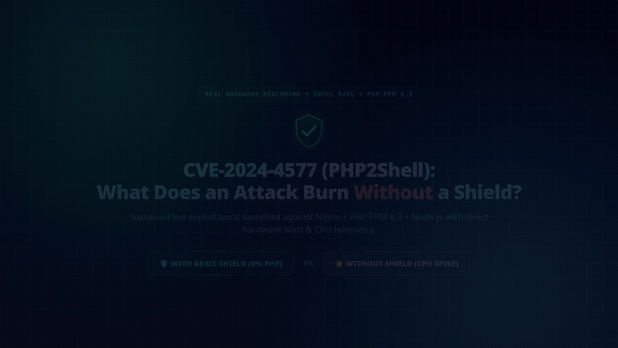

# 🛡️ Aegis by AIVO — Sovereign Zero-Trust Suite & ESG Cockpit (AGPLv3)

<p align="center">
  <strong>English</strong> | <a href="README.fr.md">Français</a> •
  <a href="VISION.md">Vision & Principles</a> •
  <a href="ROADMAP.md">Roadmap</a> •
  <a href="CHANGELOG.md">Changelog</a> •
  <a href="CONTRIBUTING.md">Contributing (Gitflow)</a> •
  <a href="SECURITY.md">Security</a> •
  <a href="LICENSE">License (AGPLv3)</a>
</p>

<p align="center">
  
  
  
  
  
  
  
</p>

<p align="center">
  <a href="https://demo.aegis.aivo.fr" target="_blank">
    
  </a>
  <a href="https://github.com/aivo-labs/aegis/releases/tag/v1.3.0-beta">
    
  </a>
  <a href="https://aegis.aivo.fr" target="_blank">
    
  </a>
</p>

> [!TIP]
> **Test Aegis in 1 click (No installation required)**: You can explore the real-time Shannon entropy fuzzer, the comparative PHP2Shell hardware replay, and the SOC Kanban directly on our in-browser showcase: **[demo.aegis.aivo.fr](https://demo.aegis.aivo.fr)**.

**Operational Control Center (SOC), In-Line Protection (Ingress/Egress) & Verifiable Hardware Energy Governance (RGESN / ANSSI / EFRAG)**

Aegis is a unified software suite built to protect SMB and mid-market information systems while auditing and reducing their environmental footprint under the **Ethical Open-Core (AGPLv3)** model. Engineered in **native Go and Rust**, Aegis runs as an ultra-frugal, transparent overlay (< 200 MB RAM excluding local LLM weights) with zero per-seat SaaS tax.

---

## ⚡ Live Hardware Benchmark: CVE-2024-4577 (PHP2Shell) — With vs Without Shield

<p align="center">
  
</p>

> *Measured locally on `Intel(R) Core(TM) i5-8350U CPU @ 1.70GHz (8 vCPUs)` via direct hardware silicon counters (`/sys/class/powercap/intel-rapl:0` + `/proc/stat`) against an Nginx + PHP-FPM 8.3 + Node.js stack under sustained `CVE-2024-4577` burst (`602` blocked requests vs `126` unshielded exploits).*

| Measured Metric | 🛡️ With Aegis Shield (Edge PEP) | 💥 Without Shield (Exposed PHP-FPM 8.3) | Impact |
| :--- | :---: | :---: | :---: |
| **PHP2Shell Interception** | **100%** (`602 / 602` HTTP `403`) | **0%** (`126 / 126` HTTP `200` exploited) | Complete perimeter block |
| **PHP-FPM Container CPU** | **0%** avg / **0%** peak | **537.98%** avg / **743.4%** peak | Zero app CPU burn |
| **Intel RAPL Power (Avg / Peak)** | **5.81 W** / **16.01 W** | **24.14 W** / **37.58 W** | **+315.5%** avg Watts w/o shield |
| **Measured Energy Consumed** | **101.04 J** | **438.91 J** (`+337.9 J` wasted) | **×4.34** total energy |
| **Average HTTP Latency** | **17.33 ms** | **2619.57 ms** | **151×** faster response |

---

## 🏛️ Architecture & Service Topology

```
                         [ INBOUND TRAFFIC (Ingress Web & API) ]
                                           │
                                           ▼
        ┌─────────────────────────────────────────────────────────────────┐
        │      Aegis Gate PEP / WAF (apps/gate-proxy : Port 8000)         │
        │      In-Line OWASP & Automated Scanner Filter (Nikto, SQLi, RCE)│
        └────────────────────────────────┬────────────────────────────────┘
                      ┌──────────────────┴──────────────────┐
               (Blocked Traffic 403)                 (Legitimate Traffic 200)
                      │                                     │
                      ▼                                     ▼
        ┌───────────────────────────┐         ┌───────────────────────────┐
        │    Aegis Backend (Go)     │         │     Aegis Web Cockpit     │
        │    (apps/backend : 8080)  │ ◀────── │     (apps/web : 4321)     │
        │    • Triage Feed / API    │         │     • Astro 5 + Vue 3     │
        │    • Real Passive Scanner │         │     • Reverse-proxy /docs │
        └─────────────┬─────────────┘         └─────────────┬─────────────┘
                      │                                     │
                      ▼                                     ▼
        ┌───────────────────────────┐         ┌───────────────────────────┐
        │   TimescaleDB (Port 5432) │ ◀────── │   Aegis Docs (Starlight)  │
        │   (Telemetry Hypertables) │         │   (apps/docs : profile)   │
        └───────────────────────────┘         └───────────────────────────┘
                      ▲                                     ▲
                      │ (Hardware Energy Telemetry)         │ (DNS Sinkhole & AI)
        ┌───────────────────────────┐         ┌───────────────────────────┐
        │   Aegis Telemetry Agent   │         │  Aegis Egress (Port 5053) │
        │   (apps/telemetry-agent)  │         │  Hardened CoreDNS + SLM   │
        │   Rust RAPL Sensor (/sys) │         │  Nimble 9B (Ollama :11434)│
        └───────────────────────────┘         └───────────────────────────┘
```

### Port Mapping

| Service | Public Port | Technology | Operational Role |
| :--- | :--- | :--- | :--- |
| **`web`** | **`4321`** (-> 80) | Astro 5, Vue 3, Nginx | **Unified SOC & ESG Cockpit**, Kanban Triage, `/docs/` Gateway. |
| **`gate-proxy`** | **`8000`** | Go / Node.js Reverse-Proxy | **Ingress PEP / WAF Gateway** (latency < 1.5 ms, RAM < 25 MB). |
| **`backend`** | **`8080`** | Native Go (Zero-Mock) | **Go Control Plane API** (Triage feed, passive scanner, metrics). |
| **`egress-gateway`** | **`5053` (UDP/TCP)** | CoreDNS & SLM Inference | **Egress DNS Gateway** (CTI cache + Local Nimble 9B AI). |
| **`telemetry-agent`**| *Host network* | Native Compiled Rust | **Hardware Sensor** (Linux RAPL real Watts via `/sys/class/powercap`). |
| **`timescaledb`** | **`5432`** | PostgreSQL 16 + TimescaleDB| **Sovereign Secure Datastore** (Immutable logs & time-series metrics). |
| **`ollama-nimble`** | **`11434`** | Air-Gapped Ollama | **Local Nimble 9B AI** (0 tokens leaked to 3rd-party US clouds). |
| **`docs`** | *Internal* (`/docs/`) | Astro Starlight | **Official Documentation** (Docker profile `--profile docs`). |

---

## 🎛️ Architecture & Services

Aegis is architected as an autonomous, sovereign Zero-Trust stack with zero dependencies on US Big Tech clouds:

### 1. Ingress PEP & Pure BFF Token Handler (`gate-proxy:8000`)
- **Ultra-low latency (< 1.5 ms)** OWASP Top 10 WAF, Virtual Patching, and Shannon Entropy analyzer.
- **Pure BFF Token Handler**: Authenticates sessions via AES-256-GCM encrypted HttpOnly cookies (OIDC Keycloak or Standalone Sovereign Demo). Tokens never leak to browser JavaScript.

### 2. Unified SOC & ESG Cockpit (`web:4321`)
- Real-time cyber threat map, live streaming attack logs, instant WAF controls, and hardware energy metrics.
- Accessible directly or behind the Ingress PEP at `/app/`.

### 3. Community Portal (`/`)
- Minimalist, sovereign community landing page at `/` (EN) and `/fr/` (FR) providing instant 1-click access to the SOC Cockpit, live documentation, and GitHub repository.

---

## 📋 Prerequisites

* **Operating System**: Linux (Ubuntu 22.04/24.04, Debian 12, Rocky Linux 9, etc.) or macOS.
* **Docker Engine**: version 24.0+ (`docker --version`).
* **Docker Compose**: version v2.20+ (`docker compose version`).
* **Hardware Sizing**:
  * *Standard (without heavy local LLM)*: 2 vCPUs, 2 GB RAM, 20 GB SSD.
  * *Full Stack (with Nimble 9B local inference)*: 4 vCPUs, 8 GB RAM (or compatible GPU).

---

## 🚀 Quickstart

### 0. Or test the live in-browser showcase instantly
No installation required: **[demo.aegis.aivo.fr](https://demo.aegis.aivo.fr)** (English) | **[demo.aegis.aivo.fr/fr/demo](https://demo.aegis.aivo.fr/fr/demo)** (Français).

### 1. Clone the repository
```bash
git clone https://github.com/aivo-labs/aegis.git
cd aegis
```

### 2. Start the full suite
```bash
# Start all containers in sovereign mode
docker compose up -d

# (Optional) Start the official documentation container
docker compose --profile docs up -d
```

### 3. Access endpoints
- **Primary Ingress PEP & WAF Entrypoint**: `http://localhost:8000/`
- **Unified SOC & ESG Cockpit**: `http://localhost:8000/app/` (or `http://localhost:4321/app/`)
- **Sovereign Authentication (Pure BFF)**: `http://localhost:8000/login/` (EN) | `http://localhost:8000/fr/login/` (FR)
- **Technical Documentation (Starlight)**: `http://localhost:8000/docs/` (or port 4322)
- **Bilingual Support (i18n)**: English default at root URLs, French under `/fr/`, with language toggle on all headers.

---

## 🌐 VPS & PaaS Deployment (Dokploy, Coolify, Traefik)

The Aegis Nginx architecture is engineered for hassle-free deployment on VPS and container PaaS platforms:
- **Dedicated Dokploy Compose**: Use `docker-compose.dokploy.yml` on Dokploy, automatically attaching `gate-proxy` and `egress-gateway` to `dokploy-network`.
- **Zero Third-Party Port Exposure**: The Go API (`/api/`) and documentation (`/docs/`) are served transparently via Docker internal bridge networking.
- **Port-Preserved Relative Redirects**: Configured with `absolute_redirect off;` and `port_in_redirect off;`, ensuring Traefik, Caddy, or Nginx SSL proxies handle traffic without losing custom ports or SSL schemes.

---

## 🧪 Pentest Suite & Automated Benchmark

An automated security test suite is included to simulate real-world attack vectors against the in-line filters and verify live detection in the Cockpit:

```bash
./scripts/run-pentest-demo.sh
```

### Simulated & Neutralized Attack Vectors:
1. **Automated Web Scanners**: Neutralizes User-Agent `Nikto/2.1.6` (**403 Forbidden**).
2. **SQL Injections (SQLi)**: Catches `' UNION SELECT username,password FROM users--` (**403 Forbidden**).
3. **Local File Inclusion (LFI)**: Blocks `../../../../etc/passwd` traversals (**403 Forbidden**).
4. **Remote Code Execution (RCE)**: Intercepts `; cat /etc/shadow` commands (**403 Forbidden**).
5. **Cross-Site Scripting (XSS)**: Sanitizes `<script>` tag injections (**403 Forbidden**).
6. **DNS Exfiltration & C2**: Intercepts queries to suspicious domains on port `5053` (**Sinkhole 0.0.0.0**).
7. **DGA Algorithms**: Shannon entropy detection and algorithmic quarantine via the **Nimble 9B** SLM.
8. **Compliant Traffic**: Authenticated requests forwarded with sub-1.5 ms latency (**200 OK**).

---

## ⎈ Kubernetes & Helm Deployment

Aegis natively supports enterprise Kubernetes deployments with granular per-namespace power attribution via **Kepler eBPF**:

* **One-Command Helm Installation**:
  ```bash
  helm upgrade --install aegis ./deploy/kubernetes/helm/aegis \
    --namespace aegis-system \
    --create-namespace
  ```
* **Pure Manifests (GitOps / ArgoCD)**:
  ```bash
  kubectl apply -f deploy/kubernetes/manifests/
  ```

---

## 📁 Repository Structure

```
aegis/
├── apps/
│   ├── backend/            # Sovereign native Go engine (REST API, Passive scanner, Honeypot)
│   ├── docs/               # Official Astro Starlight documentation (Bilingual EN/FR)
│   ├── egress-gateway/     # Outbound DNS gateway with hardened CoreDNS & C2 Sinkhole
│   ├── gate-proxy/         # Ultra-lightweight Ingress PEP / WAF gateway (< 25 MB RAM)
│   ├── telemetry-agent/    # Native Rust hardware sensor (Real Linux RAPL Watts)
│   └── web/                # Unified frontend: Vue 3 SOC Cockpit, Kanban, Astro 5 Landing
├── deploy/
│   ├── docker-compose/     # Docker compose variations (bare-metal, enterprise)
│   └── kubernetes/         # Helm chart and native Kubernetes manifests
├── docs/                   # Whitepapers, technical benchmarks, and architecture guides
├── scripts/                # Setup scripts and automated pentest test benches
└── docker-compose.yml      # Official production Docker Compose definition
```

---

## ⚖️ License & Commitments

* **Open-Source License**: Distributed under the **AGPLv3** (*GNU Affero General Public License v3*). Fully auditable and modifiable source code.
* **Sovereign Design**: Developed in France by **AIVO Labs** — Immune to the extraterritorial US Cloud Act.
* **Regulatory Compliance**: Built for **NIS 2**, **DORA**, **RGESN 2024**, and the European **VS Standard (EFRAG 2026)**.

---

## 🧭 Development Priority Matrix

For full architectural specifications, codebase status details, and lock remediation plans, see the complete [Technical Roadmap](ROADMAP.md).  
To connect remote servers, gateways, and telemetry probes to the Control Plane, refer to the [Agent Enrollment Guide](apps/docs/src/content/docs/guides/agent.md) and the [Architecture Decision Records](docs/adr/README.md).

| Phase | Lock / Module | Status | Priority | Codebase Scope | Major Security & GreenOps Gain |
| :--- | :--- | :---: | :---: | :--- | :--- |
| **v1 Base** | **Ingress WAF, PHP2Shell VP, Pure BFF & RAPL Cockpit** | **✅ Delivered** | **v1 Core** | `gate-proxy`, `backend`, `telemetry-agent`, `web` | `< 1.5 ms` idle edge PEP, HTTP `413` (`32 KB`), `100%` PHP2Shell mitigation (`0%` app CPU), OIDC Pure BFF & live CSRD RAPL PDF/CSV |
| **P0/P1** | **#1 Strict Egress Network Confinement** | **✅ Delivered** | **P0 (Critical)** | `docker-compose*.yml`, `egress-gateway`, eBPF | Blocks raw-IP TCP reverse shells bypassing DNS (`internal: true` bridge + dynamic `DnsToIpAllowlist`) |
| **P0/P1** | **#2 Multi-Encoding Normalization (Base64 / HTML)** | **✅ Delivered** | **P1 (High)** | `apps/gate-proxy/src/engine/canonicalizer.ts` | Recursive 3-pass URL canonicalization, HTML entity decoding, Hex/Unicode escapes & Base64 payload decoding |
| **P0/P1** | **#3 Volumetric Rate-Limiting & Auto IP Quarantine** | **✅ Delivered** | **P1 (High)** | `apps/gate-proxy/src/quarantine/ip-reputation.ts` | Sliding-window rate limiting (`60 req/10s`) & automated 15-minute Auto-Jail after 3 critical WAF blocks |
| **P0/P1** | **#4 HTTP Protocol Hardening (`431`) & Shell-Spawn Watch** | **✅ Delivered** | **P1 (High)** | `apps/gate-proxy/src/`, `apps/telemetry-agent` | Strict `HTTP 431` header budgets (`8 KB`), RFC multipart validation & runtime shell spawn filtering (`is_benign_worker_child_cmd`) |
| **P0/P1** | **#5 Continuous Passive Posture, PQC (`ML-KEM`) & Remediation** | **✅ Delivered** | **P1 (High)** | `apps/backend/internal/scanner/` | Go passive scanner, **PQC `X25519MLKEM768` (FIPS 203)** probe, scheduled audits, drift detection & remediation wizard |
| **v1.3 (P1.5)** | **#5-Bis "Anti-Artex" Shield (Autonomous Offensive AI Defense)** | **✅ Delivered (v1.3)** | **P1.5 (High)** | `gate-proxy`, `egress-gateway` | Opaque `403`, Adaptive Tarpit & Canary Honeypot anti-LLM, OAST/LOTC Sinkhole (`interact.sh`), API BOLA/IDOR/Swagger shield, UA mismatch & BFF Context-Binding |
| **P2** | **#6 L3/L4 eBPF / XDP Kernel Filter, `SIGKILL` Kill-Switch & CVE Audit** | **⏳ In Design** | **P2 (Medium)** | `apps/telemetry-agent/src/` | NIC-level `XDP_DROP` (`< 0.005 ms`) against malformed TCP SYN options, active `< 10 ms` `SIGKILL` on rogue shell spawn + `uname -r` alerts |
| **P2** | **#7 Enterprise DNS Filtering & Shadow IT (DoH/DoT)** | **⏳ Planned** | **P2 (Medium)** | `apps/egress-gateway/src/` | Central DHCP/`:5053` + remote DoH/DoT resolver regulating RAT tools (TeamViewer, AnyDesk, RustDesk) in Prod/DMZ |
| **P2** | **#8 Frugal Rust Endpoint Agent (`< 10 MB`) & PQC `mTLS`** | **⏳ In Design** | **P2 (Medium)** | New `aegis-node-agent` (Rust) + `web` | Cross-platform workstation CVE & hygiene probe over **hybrid post-quantum `mTLS` (`X25519MLKEM768`)** + conditional access |
| **P2** | **#9 "Assume Breach" ZTNA Micro-Segmentation** | **⏳ In Design** | **P2 (Medium)** | Network architecture & PEP | Eliminates direct L3 office-to-DB routes + adds internal ARP/port-scan honeypot alerting |
| **P3** | **#10 "Two-Door" AI Governance & Zero-Secret Egress** | **⏳ In Design** | **P3 (R&D)** | `gate-proxy` (Edge) & `egress-gateway` | Inbound Prompt Injection guardrails + **Zero-Secret Placeholder** (zero API keys in agent sandbox, PII scrubbing & boundary injection) |
| **P3** | **#11 Zero-Trust MCP Gateway & PQC AI Act Ledger** | **⏳ In Design** | **P3 (R&D)** | `gate-proxy`, host `seccomp`/eBPF & `backend` | Per-identity MCP (`tools/list`, `tools/call`) filtering, kernel sandboxing & immutable **`Ed25519 + ML-DSA` (FIPS 204)** audit ledger |
| **P3** | **#12 Collaborative P2P CTI & `< 1B` CPU Micro-SLMs** | **🚧 Partial** | **P3 (R&D)** | `apps/egress-gateway/src/cti/blocklist.ts`, Ollama | Static C2 blocklist + resilient **Nimble 9B / Qwen 0.5B** SLM **done**; adds live Abuse.ch/CERT-FR/CISA KEV sync, P2P node sharing |

> [!NOTE]
> **Lifecycle & Production Hardening**: Aegis operates under an active **Public Beta** lifecycle. While all frontline perimeter locks (P0/P1) are operational and hardened, the platform will formally graduate to **General Availability (GA / Production LTS)** upon field validation of milestones P2 and P3.

