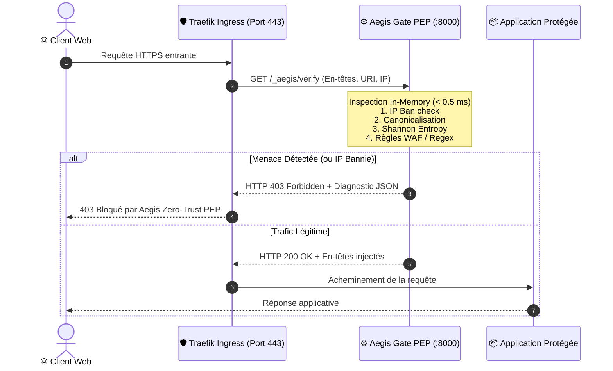

# ADR-0002 : Traefik ForwardAuth PEP Ingress & WAF In-Memory Zero-Latency

* **Statut** : **Accepté**
* **Date** : 2026-11-09
* **Décideurs** : Équipe Architecture Aegis & Aivo Labs
* **Périmètre** : `apps/gate-proxy`, Ingress Traefik, Traefik ForwardAuth Middleware

---

## 1. Contexte & Problématique

Traefik est le reverse-proxy d'entrée principal sur le VPS de production, assurant le routage des noms de domaine, la gestion des certificats Let's Encrypt et la communication avec Dokploy.

Pour protéger les applications souveraines et les sites hébergés (`aivo.fr`, `aegis.aivo.fr`, `nicolas.baud.dev`, etc.) contre les attaques web automatisées (scanners Nikto/Nuclei, bots CMS, injections SQL, RCE, traversal path, SSRF), nous avions besoin d'un **moteur WAF d'inspection Zero-Trust (PEP — Policy Enforcement Point)** qui respecte les contraintes suivantes :
1. **Ultra-faible latence** : Moins d'une milliseconde d'impact sur le temps de traitement des requêtes HTTP.
2. **Autonomie & Frugalité** : Aucun recours à des services cloud tiers payants ou des agents lourds (ex: Cloudflare WAF, ModSecurity C++ lourd ou AWS WAF).
3. **Protection contre le déni de service administratif** : Le WAF ne doit sous aucun prétexte bloquer l'accès au tableau de bord Dokploy ou verrouiller l'adresse IP de l'administrateur en cas d'alerte.

---

## 2. Décision Architecturale

Nous mettons en œuvre le patron **Traefik ForwardAuth** couplé à un moteur WAF in-memory hautement optimisé dans [`apps/gate-proxy`](../../apps/gate-proxy).

### 2.1 Mécanisme d'Inspection Ingress Traefik

### 2.2 Pipeline d'Évaluation In-Memory

L'inspection WAF est orchestrée de manière déterministe et séquentielle en mémoire vive :
1. **Contrôle d'immunité administrative** : Les adresses IP de maintenance et hôte local (`127.0.0.1`, `92.157.163.164`) sont protégées par une règle d'immunité stricte afin de proscrire tout bannissement accidentel de l'opérateur.
2. **Vérification de la réputation IP (Fast-Path O(1))** : Recherche dans l'ensemble mémoire des adresses bannies (`ip_ban_list`). Blocage immédiat sans calcul regex coûteux.
3. **Bypass des routes d'authentification OIDC** : Les chemins `/api/auth/*` (échange de codes d'autorisation Keycloak) sont exemptés d'analyse heuristique SQLi afin d'éviter les faux positifs sur les tokens contenant des caractères spéciaux ou tirets doubles.
4. **Vérification de la taille de charge utile (413 Payload Too Large)** : Rejet immédiat si le corps dépasse `maxPayloadBytes` (défaut : 32 Ko).
5. **Canonicalisation Récursive** : Décodage en boucle des encodages multiples (ex: `%252e%252e%252f` -> `../`), suppression des octets nuls (`%00`) et normalisation des commentaires SQL.
6. **Analyse de l'Entropie de Shannon $H(X)$** : Détection des charges utiles générées par des générateurs d'aléas ou des payloads d'exfiltration masqués.
7. **Matrice de Règles WAF Hybrides Spécialisées** :
   * `ScannerRule` : Détection des User-Agents de scan (Nikto, Nuclei, Sqlmap, Gobuster, WPScan).
   * `ZeroDayRule` : Détection Log4j / JNDI, PHP2Shell, CVE Spring4Shell.
   * `RceRule` : Détection d'injections de commandes système bash/sh (`cat /etc`, `wget`, `curl`, `chmod`).
   * `SsrfRule` : Détection des métadonnées cloud (`169.254.169.254`, AWS/GCP metadata).
   * `SqliRule` : Détection délimitée des requêtes SQL (`UNION SELECT`, syntaxe de commentaires SQL validée).
   * `TraversalRule` : Détection d'accès aux fichiers sensibles (`/etc/passwd`, `/etc/shadow`, `boot.ini`).
   * `SensitiveProbeRule` : Détection de sondes `.env`, `.git`, `.aws/credentials`, `phpinfo.php`.
   * `CmsProbeRule` : Détection de sondes WordPress (`wp-login.php`, `xmlrpc.php`, `wp-config.php`).
   * `XssRule` : Détection des balises `<script>`, `onerror=`, `javascript:`.

---

## 3. Conséquences

### 3.1 Avantages (Positifs)
* **Performance exemplaire** : Temps moyen d'évaluation d'une requête mesuré entre **0,3 ms et 0,6 ms**.
* **Zéro rupture de compatibilité** : Fonctionne avec n'importe quelle application conteneurisée derrière Traefik sans modifier son code source.
* **Traçabilité totale** : Chaque décision (bloquée ou autorisée) alimente la table d'audit `security_audit_logs` de TimescaleDB pour analyse médico-légale ANSSI.

### 3.2 Garde-fous & Bonnes Pratiques
* **Isolation du middleware Traefik** : Le middleware `aegis-auth-pep` ne doit **jamais** être appliqué sur le routeur Traefik interne de Dokploy (dashboard Dokploy), assurant que l'interface d'administration reste toujours opérationnelle même en cas d'anomalie sur le WAF.
