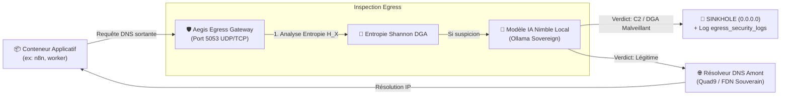

# ADR-0003 : DNS Sinkhole Egress & Filtrage Anti-Exfiltration C2 (Port 5053)

* **Statut** : **Accepté**
* **Date** : 2026-11-09
* **Décideurs** : Équipe Architecture Aegis & Aivo Labs
* **Périmètre** : `apps/egress-gateway`, Sécurité Réseau Egress, Ollama Nimble IA

---

## 1. Contexte & Problématique

La sécurité périmétrique classique se focalise quasi-exclusivement sur les flux entrants (Ingress). Or, dans un environnement moderne hébergeant des conteneurs applicatifs et des workflows d'automatisation (ex: n8n, runners CI/CD, dépendances open-source compromises), les attaques les plus destructrices exploitent les **flux sortants (Egress)** :
* **Ransomwares & Reverse Shells** : Tentatives de connexion vers des serveurs Command & Control (C2) pour télécharger des charges utiles ou recevoir des ordres.
* **Exfiltration de données via DNS Tunneling** : Encodage de données sensibles dans des sous-domaines à forte entropie (ex: `data-exfil.xyz123abc456.evil.com`) contournant les pare-feux conventionnels.
* **Algorithmes de Génération de Domaines (DGA)** : Domaines éphémères générés dynamiquement par des botnets pour échapper aux listes noires statiques.

Inspecter l'ensemble du trafic HTTPS sortant par déchiffrement TLS (MITM) est lourd, complexe, énergivore et pose de sérieux problèmes de confidentialité (RGPD).

---

## 2. Décision Architecturale

Nous déployons une **Passerelle de Filtrage Egress DNS & Sinkhole** autonome ([`apps/egress-gateway`](file:///home/andjurka/Work/aivo/Sites/Aegis/apps/egress-gateway)) écoutant sur le port **5053 (UDP & TCP)**, raccordée au réseau interne des conteneurs.

### 2.1 Pipeline d'Analyse et de Décision

1. **Calcul d'Entropie Shannon $H(X)$ sur le FQDN** :
   Les noms de domaine issus d'algorithmes DGA ou de tunneling présentent une dispersion statistique des caractères anormalement élevée ($H(X) > 3.8$).
2. **Évaluation Rapide par IA Locale Souveraine (Ollama Nimble)** :
   Si le domaine présente un score de risque ou une entropie anormale, le modèle local System One évalue la sémantique et la structure du domaine sans faire fuiter la moindre donnée vers un cloud public.
3. **Application du Sinkhole (0.0.0.0)** :
   Si le domaine est classifié malveillant, la passerelle renvoie l'adresse IP `0.0.0.0`, neutralisant instantanément la connexion du malware avant même l'établissement de la socket TCP.
4. **Audit Immuable** :
   Chaque interception sortante alimente la table `egress_security_logs` avec l'adresse IP interne du conteneur émetteur, le FQDN ciblé, l'entropie et la latence.

---

## 3. Conséquences

### 3.1 Avantages (Positifs)
* **Blocage proactif à la racine** : La menace est neutralisée au stade de la résolution DNS, rendant impossible l'établissement du canal de fuite de données.
* **Zéro déchiffrement TLS requis** : Respect total de la vie privée et de la confidentialité des échanges applicatifs légitimes.
* **Frugalité** : Consommation CPU négligeable, traitement en mémoire asynchrone pour ne pas ralentir les requêtes applicatives normales.

### 3.2 Points d'Attention
* Les conteneurs nécessitant une protection Egress doivent avoir leur résolveur DNS configuré sur l'adresse de la passerelle Aegis (`nameserver aegis_egress_gateway` ou port `5053`).
